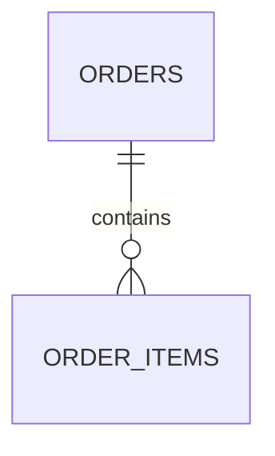

# 任务 3.2 提交文档:数据设计

姓名:　　　　学号:　　　　日期:

> 提示:截图放在 `images/` 目录,文中写文件名。设计部分必须在使用 Agent **之前**完成。填完后删除所有提示和示例行。

## 一、设计

**旧设计的问题**(想查哪个菜点得最多?改价后历史订单要不要变?):

**表与关系**
| 表 | 保存什么 | 与其他表的关系 |
|---|---|---|
| | | |

**各表的列**(每张表一份)
| 列名 | 类型 | 约束(主键 / 外键 / 非空) | 含义 |
|---|---|---|---|
| | | | |

**数据关系图**

**为什么这样拆**:

**价格快照**(明细里保存什么价格,为什么):

**事务**(哪些写入必须一起成功或一起撤销):

## 二、验收记录

| 检查项 | 结果 | 证据 | 说明 |
|---|---|---|---|
| 3.1 的验收项重新全部通过(回归) | | | |
| 重建脚本后表和初始数据正确 | | | |
| 订单与明细正确关联,外键检查已生效 | | | |
| 改菜品价格后历史订单金额不变 | | | |
| 明细写入失败后,订单表没有残留 | | | |

**未通过项的原因和修改**:

## 三、代码走读与协作

- 创建两张表的语句和外键声明在哪?打开外键检查的代码在哪?
- 事务从哪里开始、在哪里提交或撤销?
- 对外接口为什么没有变:
- 我没看懂的地方:

## 提交前自检
- [ ] 设计在使用 Agent 之前完成
- [ ] 每一列都写了类型、约束和含义
- [ ] 价格快照和事务都有说明
- [ ] 不提交 .db 文件