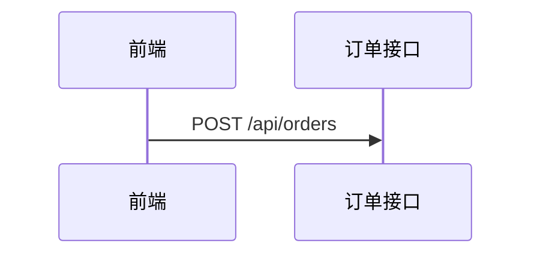

# 任务 3.3 提交文档:系统设计

姓名:　　　　学号:　　　　日期:

> 提示:截图放在 `images/` 目录,文中写文件名。设计部分必须在使用 Agent **之前**完成。填完后删除所有提示和示例行。

## 一、设计

**模块与职责**
| 模块 | 负责 | 不负责 |
|---|---|---|
| | | |

**订单状态**
| 状态 | 含义 | 可以转到 |
|---|---|---|
| | | |

**异常清单**
| 异常 | 发生在哪一步 | 订单状态怎么变 | 返回前端(状态码和内容) | 数据库留下什么 | 设计理由 |
|---|---|---|---|---|---|
| 菜品已售罄 | | | | | |
| 支付失败 | | | | | |
| 支付超时 | | | | | |
| 重复提交 | | | | | |

**支付超时为什么不能当作失败,我的处理方式**:

**重复提交方案**(请求标识由谁生成、保存在哪、保存多久、再次收到时怎么处理):

**顺序图**(正常流程和每个异常各一张,绘图方式以老师要求为准)

## 二、验收记录

| 场景 | 模拟支付配置 | 返回 | 订单状态 | 数据库记录 | 与设计一致 | 截图 |
|---|---|---|---|---|---|---|
| 正常流程 | 成功 | | | | 是 / 否 | |
| 支付失败 | 失败 | | | | 是 / 否 | |
| 支付超时 | 超时 | | | | 是 / 否 | |
| 重复提交 | 成功 | | | | 是 / 否 | |
| 菜品已售罄 | — | | | | 是 / 否 | |

**不一致项**(判断改设计还是改代码,并写理由):

## 三、代码走读与协作

- 各模块对应哪些文件?订单状态在哪里变化?处理重复提交的代码在哪?
- 让 Agent 复述设计时,它有没有理解错的地方:
- 我没看懂的地方:

## 提交前自检
- [ ] 设计和顺序图在使用 Agent 之前完成
- [ ] 每个异常都回答了发生在哪、状态怎么变、返回什么、数据库留下什么
- [ ] 支付超时没有被当作失败
- [ ] 每个异常场景都验证了返回、状态和数据库记录