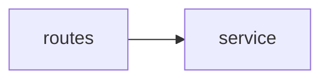

# 任务 6.1 提交文档:架构分析与决策记录

姓名:　　　　学号:　　　　日期:

> 提示:依赖图和问题清单要在使用 Agent **之前**完成。本任务不修改业务代码。填完后删除所有提示和示例行。

## 一、现状还原

**模块与职责**
| 模块(文件或目录) | 现在承担的职责 | 本应承担的职责 |
|---|---|---|
| | | |

**现状依赖图**(箭头表示谁依赖谁;可用 Mermaid 或图片放在 `images/`)

**依赖图的检查方式**(手工核对 / 脚本辅助,及脚本的结果):

**架构问题清单**
| 编号 | 问题 | 证据(文件、依赖) | 影响的质量属性 | 严重程度(高 / 中 / 低) |
|---|---|---|---|---|
| A1 | | | | |

## 二、方案与比较
| 问题编号 | 备选方案 | 好处 | 代价 | 我的倾向及理由 |
|---|---|---|---|---|
| A1 | 方案 1: | | | |
| A1 | 方案 2: | | | |

## 三、Agent 的评审与我的取舍
| Agent 的意见 | 我核对的结果 | 采纳 / 拒绝 | 理由 |
|---|---|---|---|
| | | | |

## 四、架构决策记录
### ADR-1:(标题)
- 状态:建议 / 已决定
- 背景(问题和证据):
- 决策:
- 备选方案(为什么没选):
- 后果:好处:　　代价:

(每个主要决策一份,可复制本节。)

## 提交前自检
- [ ] 依赖图和问题清单在使用 Agent 之前完成
- [ ] 每个问题都有证据和对应的质量属性
- [ ] 每个决策都写了备选方案和代价
- [ ] 每条 Agent 的意见都写了核对结果和取舍
